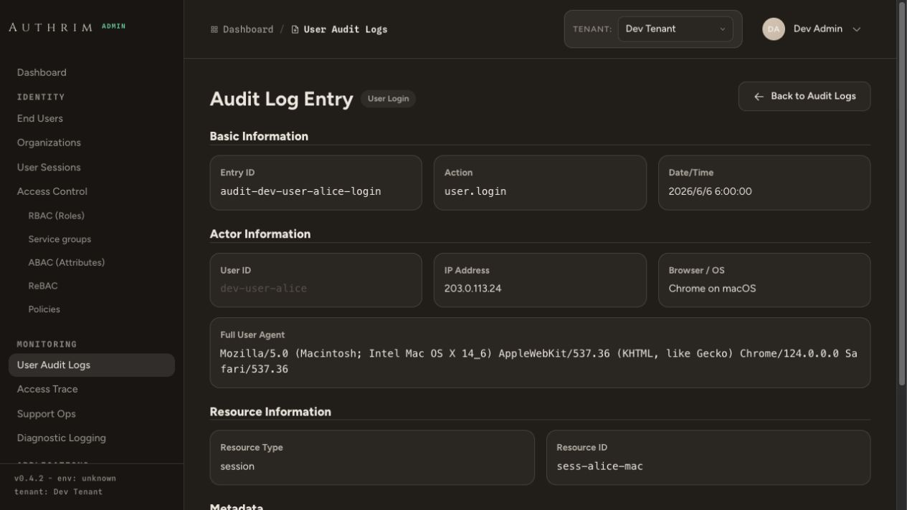

# Logging and Operational Evidence

Authrim uses two related logging layers:

- **Runtime structured logs** for developer/operator visibility during request handling.
- **Managed operational evidence** for audit records, diagnostic detail, sensitive detail chunks,
  archive delivery, external sinks, retry state, and administrative review.

The managed layer is backed by `ar-lib-logging`, Admin UI control pages, setup-managed R2/D1
resources, and tenant-aware runtime policy snapshots.

## Runtime Structured Logs

Workers use the shared logger from `@authrim/ar-lib-core`.

```typescript
import { getLogger } from '@authrim/ar-lib-core';

export async function handler(c: Context<{ Bindings: Env }>) {
  const log = getLogger(c).module('AUTH');

  log.info('Login completed', {
    clientId: 'client_123',
    durationMs: 42,
  });

  return c.json({ ok: true });
}
```

Standalone jobs and Durable Objects can use `createLogger()`.

```typescript
import { createLogger } from '@authrim/ar-lib-core';

const log = createLogger({ tenantId: 'default' }).module('SCHEDULER');
log.info('Job started');
```

### Runtime Log Configuration

| Variable           | Meaning                            | Default | Values                           |
| ------------------ | ---------------------------------- | ------- | -------------------------------- |
| `LOG_LEVEL`        | Minimum emitted level              | `info`  | `debug`, `info`, `warn`, `error` |
| `LOG_FORMAT`       | Console format                     | `json`  | `json`, `pretty`                 |
| `LOG_HASH_USER_ID` | Replace `userId` with `userIdHash` | `false` | `true`, `false`                  |

Production deployments should normally use JSON logs at `info` or higher. `debug` is intended for
development or tightly scoped incident windows.

### Standard Context Fields

| Field                   | Meaning                                                               |
| ----------------------- | --------------------------------------------------------------------- |
| `timestamp`             | ISO timestamp generated by the logger.                                |
| `level`                 | `debug`, `info`, `warn`, or `error`.                                  |
| `tenantId`              | Tenant resolved from request context or explicit logger context.      |
| `requestId`             | Request correlation identifier.                                       |
| `module`                | Component/module name set by `.module()`.                             |
| `userId` / `userIdHash` | User identifier or hashed user identifier depending on configuration. |
| `clientId`              | OAuth/OIDC client identifier.                                         |
| `sessionId`             | Session identifier when safe to include.                              |
| `action`                | Operation name.                                                       |
| `durationMs`            | Operation duration.                                                   |

Do not log raw tokens, authorization codes, passkey challenge material, SAML messages, credential
secrets, raw PII, or full unreviewed exception payloads.

## Managed Logging Model

Managed logging separates what happened from where evidence is stored.

| Concept        | Current implementation                                                                                           |
| -------------- | ---------------------------------------------------------------------------------------------------------------- |
| Log types      | `normal`, `audit`, `admin_audit`, `security`, `pii`, `diagnostic`, `job`, `webhook`, `operational`               |
| Planes         | `primary`, `archive`, `external_sink`, `sensitive_detail`, `diagnostic_detail`, `delivery_event`                 |
| Destinations   | R2, AWS S3, HTTP sink, Cloudflare Logpush, Analytics Engine, Firehose, external, custom                          |
| Capabilities   | `archive_write`, `sensitive_detail_write`, `log_sink_write`, `dlq_replay_payload_write`, `export_artifact_write` |
| Scopes         | Platform, tenant, and shared destinations                                                                        |
| Delivery lanes | `critical`, `default`, `bulk`                                                                                    |

Runtime code resolves a tenant-aware logging policy snapshot for recording, retention, and
external delivery. Cloudflare Setup owns the searchable-log storage mode described below;
logging policies cannot switch it back to a former database or JSON archive format. Platform
defaults apply when a tenant does not publish an override.

## Storage Destinations

Storage destinations are the controlled inventory for object stores and external logging targets.
They are used by audit archive, diagnostic detail, sensitive detail, import/export artifacts, DLQ
payloads, and other operational surfaces.

Supported provider categories include:

| Provider              | Typical use                                                             |
| --------------------- | ----------------------------------------------------------------------- |
| `r2`                  | Setup-managed Cloudflare R2 buckets and tenant/platform object storage. |
| `aws_s3`              | External object archive or customer-controlled storage.                 |
| `http`                | Generic HTTPS log sink.                                                 |
| `logpush`             | Cloudflare Logpush destination metadata.                                |
| `analytics_engine`    | Cloudflare Analytics Engine collector metadata.                         |
| `firehose`            | AWS Firehose style external collector metadata.                         |
| `external` / `custom` | Connector-specific or deployment-specific destinations.                 |

Setup-managed R2 bindings are displayed in Admin UI as read-only storage destinations when present.
Typical setup bindings include `PUBLIC_ASSETS`, `LOG_ARCHIVE`, `IMPORT_ARTIFACTS`,
`EXPORT_ARTIFACTS`, and `SENSITIVE_DETAILS`. `LOG_ARCHIVE` holds the Iceberg table and encrypted
log-delivery retry objects. Retry, import/export, and sensitive business artifacts have separate
ownership and cleanup rules; their existence does not create a second searchable log copy.
`PUBLIC_ASSETS` stores both Login UI media under `public/<tenant>/login-ui/` and user avatars under
`avatars/<tenant>/users/`; the bucket remains private and objects are served through authenticated or
purpose-specific Worker routes.

Tenant-usable destinations include tenant-owned destinations plus platform/shared destinations that
are eligible for the tenant and the requested log type/plane.

## Cloudflare Log Storage

Initial CLI and Web Setup ask whether to use Pipelines. Both choices store future searchable
logs as Parquet records in an owned Iceberg table in R2 Data Catalog.

| Setup mode  | At event creation                                                                                                                                                 | Afterward                                                                                                                                                                                  |
| ----------- | ----------------------------------------------------------------------------------------------------------------------------------------------------------------- | ------------------------------------------------------------------------------------------------------------------------------------------------------------------------------------------ |
| `pipeline`  | Encrypt the record and persist a private R2 retry body with a small durable outbox pointer; enqueue its reference. No searchable body is written to the database. | Management sends the record to the Stream; Cloudflare writes Parquet into Iceberg. This mode never rereads database log bodies for export. Search visibility may lag by a few minutes.     |
| `scheduled` | Store the encrypted record in bounded Admin DB parts.                                                                                                             | Export bounded batches to Parquet after the configured DB residence period. Delete only the exact staged records whose committed snapshot, batch identity, and lineage have been verified. |

The scheduled defaults are seven days in the database and a five-minute export interval. This
residence period is separate from the event's total retention deadline. The original deadline is
preserved through retries and tenant restores; an expired record is excluded even while physical
cleanup is pending. General audit, operational, and Access Trace defaults are 90 days, PII audit
365 days, and diagnostic logs 30 days. Datasets without an existing finite deadline remain
unbounded rather than inheriting a new universal cutoff.

Setup generates the owned resources, scoped bindings, stable content-HMAC key, and versioned
encryption keys. It validates and stores separately supplied Catalog credentials. Activation requires signed deployment readiness checks, owned-table/schema verification,
and complete producer configuration. Pipeline setup verifies the paid
Workers entitlement before creating resources. Neither a successful Queue send nor a Stream
acknowledgement is proof that a row is already queryable.

This storage contract has no compatibility fallback for former JSON/chunk formats and does not
backfill existing data. Local development without a remote Catalog supports encrypted hot staging
only: responses explicitly identify `local_hot_only`, cold coverage is unavailable, and staged
bodies are retained rather than pretending that an export succeeded. This local flag cannot be
deployed as a Cloudflare storage configuration. AWS runtime audit ports keep their separate
runtime-owned storage contract.

### Audit and protected details

End-user and protocol events use the shared audit service. Administrator evidence, Flow sign-in
failures, access traces, operational events, PII audits, and diagnostic records use the same
Cloudflare log-storage boundary. Legacy audit producers write the canonical `core.event_log`
dataset instead of maintaining a second `core.audit_log` body copy.

Searchable overview columns remain ordinary Parquet columns. The event body is encrypted with
Authrim keys before storage. Administrator before/after/full metadata, operational reason details,
and PII values have an additional protected-detail envelope and are decrypted only after the
corresponding permission check. Trusted actor/proxy projections are supplied separately. Keys and
decrypted bodies are not sent to an external SQL service.

Business state is retained separately from searchable evidence: Mapping commit/CAS ledgers,
revocation and atomic-audit receipts, approvals, job checkpoints, delivery claims, retry state,
and counters are not removed by general log export. Core mutations that use source-bound publication publish their log
only after the source commit is confirmed. Backup/replication admission covers their
storage effects; unknown completion is not inferred from an expired lease.

### Lists, details, and statistics

Existing Management APIs and screens read the new records with their tenant, subject, permission,
and protected-detail restrictions intact. Scheduled reads combine staged records with a fixed
Catalog snapshot and verify the source-deletion watermark. Pipeline reads use Iceberg and report
eventual visibility. Stable tenant/dataset/event identities and content HMACs remove duplicate
copies before list or aggregate evaluation.

SQL evaluation uses fixed internal queries inside the authorized Worker after decryption; it does
not expose arbitrary SQL. Cursor responses include `has_more` and `next_cursor`. Continue with
the same tenant, endpoint, and filters, and follow the endpoint's existing detail/timestamp
parameters. Changing a filter or tenant starts a new traversal.



For Management log queries using the shared query adapter, Catalog ancestry, checksum, decryption,
subject erasure, retention, and bounded-read failures produce HTTP 503 with `error: log_query_incomplete` and `complete: false`. A partial statistic is
not returned as a definitive count or zero. Reads have row, decoded-byte, object/range-read,
SQL-view, and elapsed-time budgets; narrow the time range when the selected data cannot fit.
Physical retention uses Iceberg snapshot/delete/GC rules and capture pins, rather than deleting
Parquet files while live snapshots still reference them. Tenant backup/restore exports logical
records, preserves original expiry, and re-encrypts for the target instead of copying shared
Parquet or source-wide keys.

## Permission Check Audit (Access Trace)

Permission-check audit records (Access Trace) are enabled by default when the Check API is
enabled. Denied decisions are selected for logging and allowed decisions are sampled at 1%;
the default retention is 90 days. This does not enable the Check API itself. An explicit
`audit.check_api_enabled: false` platform setting or `ENABLE_CHECK_API_AUDIT=false` environment
override disables recording; saved platform settings take precedence over the environment.
The default `waitUntil` mode records asynchronously, and recording failures do not fail the
authorization request.

## Diagnostic and Sensitive Detail

Diagnostic logging is designed to preserve operational evidence without putting sensitive data into
normal audit rows or console logs.

| Plane               | Purpose                                                                    |
| ------------------- | -------------------------------------------------------------------------- |
| `diagnostic_detail` | Short-retention operational detail for troubleshooting.                    |
| `sensitive_detail`  | Separately protected detail records for sensitive administrative evidence. |

Searchable log details use the encrypted row and protected-detail envelopes described above.
Diagnostic recording remains disabled by default; enabling it uses the Setup-selected storage
mode, without a second legacy R2 JSONL output.

Separately protected business artifacts, such as delivery/recovery payloads and export results,
can still use the sensitive-detail chunk/index contract in `DB_ADMIN`, `LOGGING_INDEX_DB`, or
`DB`. Their object references, checksums, key versions, permissions, and cleanup lifecycle are
not an alternate archive for searchable logs.

Sensitive detail export requires the dedicated sensitive-detail export permission. Probe/read
operations are audited and should be treated as privileged administrative actions.

## Delivery, Retry, and DLQ

Managed delivery is queued and observable.

| Surface         | Purpose                                                                                 |
| --------------- | --------------------------------------------------------------------------------------- |
| Delivery events | Per-destination status, attempts, retry timing, and error class.                        |
| Aggregates      | Time-bucketed delivery summaries for Admin UI dashboards.                               |
| DLQ items       | Failed delivery payload references with replay/delete/purge lifecycle.                  |
| Message jobs    | Retry and export-build jobs with leases, attempts, idempotency, and redacted summaries. |

DLQ replay works from stored payload references. Operators can preview payload metadata, replay
eligible items, mark items deleted, or purge replay payloads depending on permissions and policy.
Message-job payloads are encrypted with the common object-envelope contract and pinned with a
plaintext checksum. Readers fail closed when encryption metadata is absent or integrity verification
fails. Terminal jobs delete their payload immediately; the scheduled orphan scan provides recovery
when that best-effort deletion is interrupted.

## Runtime Policy Snapshots

Logging policy changes are not just draft database rows. Operators publish runtime policy snapshots
so Workers can resolve a stable logging plan.

Policy data includes:

- destination assignments by `log_type` and `plane`
- fallback policies
- destination metadata and capability restrictions
- critical/fallback eligibility
- tenant and platform scope

The Admin UI exposes draft diffs, publish state, rollback-oriented history, runtime pointer checks,
and runtime topology checks.

## Admin UI Surfaces

The Admin UI exposes the following operational surfaces:

| Page                 | Purpose                                                                                  |
| -------------------- | ---------------------------------------------------------------------------------------- |
| User Audit Logs      | End-user audit search and review.                                                        |
| Admin Audit Logs     | Admin action evidence from the configured log-storage mode.                              |
| Access Trace         | Policy/access investigation support.                                                     |
| Support Ops          | Privacy-preserving support operations and approved actions.                              |
| Diagnostic Logging   | Diagnostic detail, sensitive detail policy, delivery health, DLQ, exports, and coverage. |
| Storage Destinations | R2/S3/sink inventory, credentials, health checks, and feature usage.                     |
| Database Connections | Setup-managed D1 databases and external connection inventory.                            |

### Scheduled R2 Maintenance

Management runs the standard R2 maintenance schedule every six hours. Setup emits both the cron and
an explicit `AUTHRIM_R2_MAINTENANCE_CRON_ENABLED=true` proof variable; without both the schedule is
shown as disabled. A D1 lease prevents overlapping executions. The Admin UI Jobs page shows
whether each task is enabled, its current status, its previous start/completion time, its next planned
run, and a redacted error code when the task fails. The same page shows an incremental scan for every
standard R2 bucket
with object count, total bytes, oldest object time, encryption classification, retention policy, and
overdue count where the policy has a fixed cutoff. This platform-wide Jobs view is limited to platform
administrators; tenant-scoped Jobs permission does not expose fleet storage metrics.

Each bucket is scanned only by its owning Worker: Control scans `MIGRATION_RELEASES`, Plugin Runner
scans `PLUGIN_BUNDLES`, and Management scans its owned buckets. Owners send bounded,
secret-free summaries to Control over authenticated service bindings. Control persists the aggregate
and reports missing or older-than-24-hours data explicitly as pending or stale; it never receives a
binding that would let it read another Worker's bucket.

The standard tasks cover terminal and orphaned import cleanup, unreferenced Login UI asset and
avatar cleanup, old delivery/message payload cleanup, incremental bucket metrics, logging storage
maintenance, and general object-artifact cleanup. The minute log-maintenance path separately
recovers publication and delivery state, exports scheduled-mode records, and advances bounded
retention, subject erasure, and Iceberg snapshot cleanup. Tenant and object scans are bounded and cursor-resumable. Because diagnostic retention is tenant
configured, its fleet metric does not invent a fixed overdue count. HTTP delivery, DLQ replay, and
message-job payloads in `SENSITIVE_DETAILS` use the common object-envelope encryption contract. Terminal
delivery deletes its transient payload immediately; the scheduled scan recovers payloads orphaned
before queue handoff or cleanup. Message payloads referenced by queued, claimed, running, retrying, or
blocked jobs are retained even after the orphan grace period. Closed DLQ rows are not removed until
their R2 payload has also been deleted.

## Safe Logging Rules

1. Log stable identifiers, hashes, counts, states, and error classes instead of raw payloads.
2. Keep raw PII and sensitive protocol messages out of console logs and immutable summaries.
3. Store sensitive operational detail in the sensitive-detail plane with explicit permissions.
4. Use structured fields instead of string concatenation.
5. Include `tenantId`, `requestId`, `action`, and `durationMs` when available.
6. Audit reads of sensitive operational detail.
7. Treat logging policy changes, destination credential changes, and DLQ replay as security-relevant
   administrative actions.

## Related Implementation Files

| File                                                                    | Purpose                                                      |
| ----------------------------------------------------------------------- | ------------------------------------------------------------ |
| `packages/ar-lib-core/src/utils/logger.ts`                              | Runtime structured logger.                                   |
| `packages/ar-lib-core/src/middleware/request-context.ts`                | Request context and logger binding.                          |
| `packages/ar-lib-core/src/services/logging-runtime-policy.ts`           | Runtime policy resolution.                                   |
| `packages/ar-lib-core/src/services/logging-runtime-emitter.ts`          | Runtime managed-log emission.                                |
| `packages/ar-lib-core/src/services/audit/audit-service.ts`              | Audit service and fan-out planning.                          |
| `packages/ar-lib-logging/src/registry.ts`                               | Log type and plane registry.                                 |
| `packages/ar-lib-logging/src/destinations/index.ts`                     | Destination provider schemas and capabilities.               |
| `packages/ar-lib-logging/src/delivery/`                                 | Delivery events, retry, queues, and DLQ helpers.             |
| `packages/ar-lib-logging/src/iceberg/`                                  | Parquet, Iceberg snapshot commits, readers, and GC.          |
| `packages/ar-lib-core/src/services/log-iceberg-runtime.ts`              | Encrypted staging and Pipeline retry/outbox storage.         |
| `packages/ar-lib-core/src/services/log-iceberg-read.ts`                 | Authorized retained-record reads and watermark checks.       |
| `packages/ar-management/src/log-iceberg-maintenance.ts`                 | Export, recovery, retention, and subject-erasure scheduling. |
| `packages/setup/src/core/log-archive.ts`                                | Owned resource setup and activation readiness.               |
| `packages/ar-management/src/routes/admin-management/logging-control.ts` | Admin logging control API.                                   |
